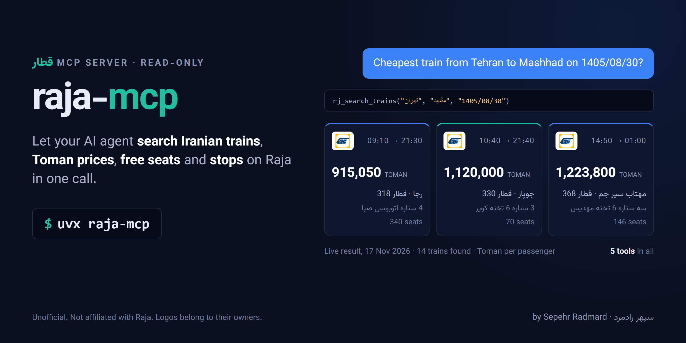

<!-- mcp-name: io.github.sepehr071/raja-mcp -->

<div align="center">



# raja-mcp: Raja (رجا) Iran train tickets MCP server for AI agents

**raja-mcp is an unofficial, read-only MCP server that lets an AI agent search Iranian passenger trains, prices in Toman and free seats on Raja (رجا, raja.ir), the national train ticket seller.**<br>
Its 5 tools find stations, search trains between two stations on a date, list every stop of a train, and read Raja's notices (presale dates, refund and boarding rules) and company news.<br>
No API key or account is needed; it works in Claude, Cursor, Copilot and any other MCP client. It needs an Iranian IP (see Limits).

[](https://pypi.org/project/raja-mcp/)
[](https://pypi.org/project/raja-mcp/)
[](https://github.com/sepehr071/raja-mcp/actions/workflows/ci.yml)
[](https://github.com/sepehr071/raja-mcp/blob/main/LICENSE)

[For AI agents](#for-ai-agents) · [Quick start](#quick-start) · [Tools](#tools) · [Limits](#limits) · [فارسی](#فارسی)

</div>

---

## For AI agents

- **What:** unofficial MCP server (model context protocol) for raja.ir: stations, one-way train search with Toman prices and free seats, train stops, notices and news.
- **Install:** `uvx raja-mcp` or `claude mcp add raja -- uvx raja-mcp`. Transport: stdio. Needs [uv](https://docs.astral.sh/uv/getting-started/installation/) (Python 3.10+).
- **Auth:** none. Optional `RAJA_MCP_PROXY` (HTTP proxy URL, or a comma-separated list); system proxy settings are ignored.
- **Access:** read-only. It cannot log in, reserve, buy or refund a ticket.
- **Tools:** 5, all prefixed `rj_`.
- **Use when:** the user asks which trains run between two Iranian cities on a date, what a ticket costs, how many seats are left, where a train stops, or when tickets for the next period go on sale.
- **Output:** compact JSON. Prices are Toman per passenger. Stations are Persian or English names or codes; dates are Jalali (`1405/08/30`) or Gregorian. Notices and news are Persian text.

## Quick start

You need [uv](https://docs.astral.sh/uv/getting-started/installation/). No API key or account. Run it from an Iranian network.

Claude Code:

```bash
claude mcp add raja -- uvx raja-mcp
```

Claude Desktop, Cursor, VS Code and other clients:

```json
{
  "mcpServers": {
    "raja": { "command": "uvx", "args": ["raja-mcp"] }
  }
}
```

Example prompts:

- "Find the cheapest train from Tehran to Mashhad on 1405/08/30."
- "Where does train 172 stop and at what times?"
- "When do Raja tickets for the next period go on sale?"
- <span dir="rtl">قطار تهران به مشهد در ۳۰ آبان را با قیمت و صندلی خالی پیدا کن.</span>
- <span dir="rtl">قطار ۱۷۲ در چه ایستگاه‌هایی توقف می‌کند؟</span>

A real answer (`rj_search_trains`, Tehran to Mashhad, 1405/08/30 = 21 Nov 2026, run 17 Nov 2026): 14 train and wagon rows. The cheapest was train 318 (Raja, 4-star bus-style Saba, 09:10 to 21:30) at 915,050 Toman with 340 seats; then train 330 (Joopar, 3-star 6-berth) at 1,120,000 Toman with 70 seats, and train 368 (Mahtab Sir Jam) at 1,223,800 Toman with 146 seats. Prices and seats change as tickets sell.

## Tools

| Tool | What it does |
|---|---|
| `rj_stations` | Find Raja railway stations and their codes by Persian or English name. |
| `rj_search_trains` | Search one-way trains between two stations on a date, with prices in Toman and free seats. |
| `rj_train_stops` | List every stop of a train with its time, from a row's `ref` of rj_search_trains. |
| `rj_announcements` | Read the notices Raja shows at the top of its site: presale dates, refund rules, boarding rules. |
| `rj_news` | List the latest Raja company news (title, Jalali date, id) or read one story's text by id. |

## Limits

- Needs an Iranian IP. raja.ir and hostservice.raja.ir answer 403 from foreign exits; the error says so. Run it from Iran, or set `RAJA_MCP_PROXY` to an Iranian proxy. The server ignores system proxy variables on purpose.
- Search is one-way, one passenger. Female-only and male-only seat groups are supported by the tool but were not compared against the site.
- `free_seats` is what the site shows: "20+" above 20, and sold-out trains are hidden unless asked.
- A train that passes the origin after midnight needs the previous day for `rj_train_stops`; the tool retries it.
- One wagon row (train 198, "پنج ستاره فدک") was in the API but not drawn on the page once; the server returns it.
- Booking, login, payment and refunds are not covered; tell the user to book on raja.ir. Raja rotates the search key and its `api-key` header with the site's code, so a site update can break the tools until the server is updated.

## How it works

Raja has no public API. The endpoints behind its search page were mapped in Chrome, and the tools were checked in Chrome against the real pages (search rows, prices, seats, stops, news and notices matched). The search query is encrypted the way the site's own script does it, using a public key the site serves. Requests use a browser-like client, a short cache and low concurrency.

## فارسی

<div dir="rtl">

raja-mcp یک سرور MCP غیررسمی و فقط‌خواندنی است که به ایجنت هوش مصنوعی اجازه می‌دهد قطارهای مسافری ایران، قیمت به تومان و صندلی‌های خالی را در سایت رجا (raja.ir) جست‌وجو کند. ایستگاه‌ها، توقف‌گاه‌های هر قطار، اطلاعیه‌ها و اخبار رجا را هم می‌خواند. خرید، رزرو و استرداد ندارد. رجا فقط از آی‌پی ایران جواب می‌دهد. نصب در Claude Code:

</div>

```bash
claude mcp add raja -- uvx raja-mcp
```

## Development

```bash
uv sync
uv run ruff check . && uv run ruff format --check .
uv run python -m pytest -q          # offline tests on recorded fixtures
uv run python -m pytest -m live -q  # live calls to raja.ir, direct Iranian line only
```

Releases: bump the version in `pyproject.toml` and `server.json`, run `uv lock`, then push a `v*` tag; GitHub Actions publishes to PyPI.

## Disclaimer

Unofficial and not affiliated with or endorsed by Raja. It is read-only and uses the public pages and API of that site, which can change without notice.

## Author

Built and maintained by **Sepehr Radmard** (سپهر رادمرد). [LinkedIn](https://www.linkedin.com/in/sepehr-radmard) · [GitHub](https://github.com/sepehr071) · more servers in [iran-mcp](https://github.com/sepehr071/iran-mcp).

## License

[MIT](https://github.com/sepehr071/raja-mcp/blob/main/LICENSE)
